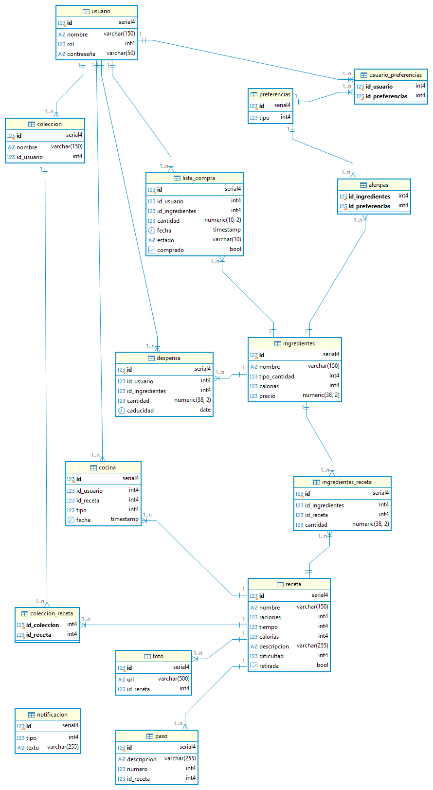

# SmartChef API

API REST de **SmartChef**, una aplicación de recetas saludables: catálogo de recetas con filtros, despensa, lista de la compra, colecciones, registro de comidas e informes.

Proyecto integrado backend · 2.º DAM · Acceso a Datos · Escuelas Profesionales Sagrada Familia (SAFA).

> **Estado:** Fase 3 (API REST) terminada. Seguridad (Fase 4), fotos, notificaciones y tareas programadas (Fase 5) y Docker (Fase 6) pendientes.

---

## Tecnologías

| Capa | Tecnología |
|---|---|
| Lenguaje | Java 25 |
| Framework | Spring Boot 4.1.1 (Web MVC, Data JPA, Validation) |
| ORM | Hibernate 7 |
| Base de datos | PostgreSQL 18 (esquema `smart_chef`) |
| Mapeo DTO ↔ entidad | MapStruct 1.6.3 |
| Código repetitivo | Lombok |
| Documentación | springdoc-openapi (Swagger UI) |
| Pruebas manuales | Postman (`docs/SmartChef API.postman_collection.json`) |
| Pruebas automáticas | JUnit 5 + `@DataJpaTest` |

## Arquitectura

```
Controller  →  Service (IXxxService / XxxServiceImpl)  →  Repository (IXxxRepository)  →  PostgreSQL
    ↑ DTOs request (@Valid)          ↑ reglas de negocio          ↑ Spring Data JPA
    ↓ DTOs response (MapStruct)      ↓ excepciones propias
                    ErrorGlobalController (@RestControllerAdvice → ProblemDetail)
```

```
src/main/java/es/safareyes/smartchef
├── config        → OpenApiConfig
├── controller    → 8 controladores REST + ErrorGlobalController
├── dtos
│   ├── request   → records de entrada con Jakarta Validation
│   └── response  → records de salida
├── entity        → entidades JPA y enums
├── exception     → ElementoDuplicado, RelacionNoEncontrada, ReglaNegocioException
├── mapper        → interfaces MapStruct (IXxxMapper)
├── repository    → interfaces Spring Data JPA
├── service       → interfaces + impl
└── validation    → validador personalizado @RangoFechas
```

---

## Cómo arrancar el proyecto

### Requisitos

- JDK 25 o superior
- PostgreSQL 18
- Maven (incluido con `mvnw`)

### 1. Crear la base de datos

Ejecuta el script `docs/smart_chef_AnaCamachoBarrio_script_definitivo.sql` sobre la base de datos `postgres`. Crea el esquema `smart_chef`, sus tablas y los datos de prueba.

### 2. Variables de entorno

| Variable | Ejemplo | Descripción |
|---|---|---|
| `DB_URL` | `jdbc:postgresql://localhost:5432/postgres?currentSchema=smart_chef,public` | URL JDBC de la base de datos |
| `DB_USER` | `postgres` | Usuario de PostgreSQL |
| `DB_PASSWORD` | `***************` | Contraseña de PostgreSQL |

En IntelliJ: *Run → Edit Configurations → Environment variables*.

### 3. Arrancar

```bash
./mvnw spring-boot:run        # Linux / macOS
mvnw.cmd spring-boot:run      # Windows
```

La API queda en `http://localhost:8080` y la documentación en **http://localhost:8080/swagger-ui.html**.

> Docker Compose: pendiente (Fase 6).

---

## Diagrama E/R



Tablas principales: `usuario`, `preferencias`, `usuario_preferencias`, `receta`, `paso`, `ingredientes`, `ingredientes_receta`, `alergias`, `despensa`, `lista_compra`, `coleccion`, `coleccion_receta`, `cocina`, `foto`, `notificacion`.

---

## Usuarios de prueba

Contraseñas solo para desarrollo. Mientras no exista la seguridad (Fase 4), el usuario se indica con el parámetro `?idUsuario=`.

| Usuario | Rol | Para qué sirve |
|---|---|---|
| `ana_chef` | CHEF | Usuario base |
| `juan_perez` (id 2) | CHEF | Usuario principal de las pruebas de Postman. Preferencias: VEGETARIANO y SINGLUTEN (RN-03) |
| `admin_pruebas` | ADMIN | Administrador |
| `invitado_01`, `invitado_02` | INVITADO | Sin contraseña |
| `semana_test` | CHEF | Endpoints 14 y 15: semana actual completa |
| `coleccion_test` | CHEF | Endpoints 12 y 13: colección vacía y receta retirada guardada |
| `cierre_test` | CHEF | Endpoints 10 y 11: lista abierta e historial de lista cerrada |
| `despensa_test` | CHEF | Endpoints 8 y 9: caducados, caducan hoy, sin caducidad, cantidad 0 |
| `sin_datos_test` | CHEF | Usuario sin datos (respuestas 200 con `[]`) |
| `lista_test_parcial`, `lista_test_completa` | CHEF | Lista de la compra con despensa parcial y completa |

---

## Endpoints (Fase 3)

| # | Método | Ruta | Descripción |
|---|---|---|---|
| 1 | GET | `/api/v1/recetas` | Catálogo con filtros y paginación (RN-02, RN-03, RN-09) |
| 2 | GET | `/api/v1/recetas/{id}` | Detalle con coste, calorías y preferencias calculadas (RN-02) |
| 3 | POST | `/api/v1/recetas` | Crear receta con ingredientes y pasos (RN-01) |
| 4 | PUT | `/api/v1/recetas/{id}` | Modificar receta (RN-01) |
| 5 | PATCH | `/api/v1/recetas/{id}` | Retirar receta, baja lógica (RN-09) |
| 6 | GET | `/api/v1/ingredientes` | Catálogo de ingredientes paginado |
| 7 | POST | `/api/v1/recetas/buscar-por-ingredientes` | Recetas con más del 50 % de ingredientes (RN-04) |
| 8 | GET | `/api/v1/despensa?idUsuario=` | Despensa ordenada por caducidad |
| 9 | PUT | `/api/v1/despensa/{ingredienteId}?idUsuario=` | Añadir/actualizar ingrediente; cantidad 0 lo elimina (204) |
| 10 | POST | `/api/v1/listas-compra/desde-receta?idUsuario=` | Añadir a la lista lo que falta de una receta (RN-05) |
| 11 | PATCH | `/api/v1/listas-compra/{idUsuario}/cerrar` | Cerrar la lista y pasar lo comprado a la despensa (RN-06) |
| 12 | GET | `/api/v1/colecciones?idUsuario=` | Colecciones con sus recetas (RN-09) |
| 13 | PUT | `/api/v1/colecciones/{nombre}/recetas/{recetaId}?idUsuario=` | Guardar receta en colección, creándola si no existe (RN-08) |
| 14 | POST | `/api/v1/registros?idUsuario=` | Registrar comida, con descuento opcional de despensa (RN-07) |
| 15 | GET | `/api/v1/registros/semana?idUsuario=&fecha=` | Resumen semanal de comidas y calorías |
| 16 | GET | `/api/v1/informes/recetas-populares?desde=&hasta=` | Top 10 más cocinadas y más guardadas |

### Códigos de error

Todas las respuestas de error usan `ProblemDetail` (RFC 9457) con `timestamp`, gestionadas en `ErrorGlobalController`.

| Código | Cuándo | Excepción |
|---|---|---|
| 400 | Validación (`@Valid`), tipo incorrecto en la URL, JSON mal formado, rango de fechas inválido | `MethodArgumentNotValidException`, `MethodArgumentTypeMismatchException`, `HttpMessageNotReadableException` |
| 404 | Usuario, receta, ingrediente o fila inexistente | `RelacionNoEncontrada` |
| 409 | Duplicados: nombre de receta, receta repetida en colección, registro del mismo día y momento | `ElementoDuplicado` |
| 422 | Reglas de negocio: pasos con huecos, ingrediente repetido, receta retirada, sin lista abierta… | `ReglaNegocioException` |

---

## Reglas de negocio

| RN | Descripción | Dónde | Estado |
|---|---|---|---|
| RN-01 | 1–30 ingredientes con cantidad positiva, pasos sin huecos, tiempo > 0, 1–12 raciones | `GuardarRecetaRequest` + `RecetaServiceImpl` | ✅ |
| RN-02 | Preferencias, coste y calorías calculados a partir de los ingredientes | `RecetaServiceImpl`, `IRecetaRepository.buscarConFiltros` | ✅ |
| RN-03 | Preferencias del perfil por defecto en búsquedas, salvo que la petición indique otras | `RecetaServiceImpl.buscarRecetas` | ✅ |
| RN-04 | Más del 50 % de ingredientes, orden descendente, faltantes, caducados no cuentan | `RecetaServiceImpl.buscarPorIngredientes` | ✅ |
| RN-05 | Escalado por raciones, resta la despensa, agrupa en la lista abierta | `ListaCompraServiceImpl` | ✅ |
| RN-06 | Cerrar lista: lo comprado pasa a la despensa y la lista queda CERRADA | `ListaCompraServiceImpl` | ✅ |
| RN-07 | Un registro por día y momento (409), sin fechas futuras, descuento sin bajar de 0 | `RegistroRequest` + `CocinaServiceImpl` | ✅ |
| RN-08 | Colección única por persona y sin recetas repetidas | `Coleccion` (unique) + `ColeccionServiceImpl` | ✅ · «Favoritas» al registrarse: Fase 4 |
| RN-09 | Receta retirada fuera de búsquedas, visible en colecciones e historial | Consultas con `r.retirada = false` | ✅ |
| RN-10 | Solo el chef autor o un admin modifica/retira (403) | — | ⏳ Fase 4 (JWT y roles) |

---

## Consultas de los repositorios (sección 3.3)

| # | Método | Formato | Repositorio | Usada en |
|---|---|---|---|---|
| 1 | `existsByNombreIgnoreCase` | Q1 | `IRecetaRepository` | Endpoints 3 y 4 |
| 2 | `findByNombreContainingIgnoreCase` | Q1 + Q6 | `IIngredientesRepository` | Endpoint 6 |
| 3 | `existsByUsuarioIdAndTipoAndFechaBetween` | Q1 | `ICocinaRepository` | Endpoint 14 |
| 4 | `findByUsuarioIdAndNombreIgnoreCase` | Q1 | `IColeccionRepository` | Endpoint 13 |
| 5 | `findByUsuarioIdAndIngredienteId` | Q1 | `IDespensaRepository` | Endpoints 9, 11 y 14 |
| 6 | `findByUsuarioIdAndEstadoOrderByFechaAsc` | Q1 | `IListaCompraRepository` | Endpoint 11 |
| 7 | `findByUsuarioIdAndIngredienteIdAndEstado` | Q1 | `IListaCompraRepository` | Endpoint 10 |
| 8 | `buscarConFiltros` | Q2 + Q5 (record) + Q6 | `IRecetaRepository` | Endpoint 1 |
| 9 | `buscarMasCocinadas` | Q2 (JOIN, COUNT, GROUP BY) + Q5 | `IRecetaRepository` | Endpoint 16 |
| 10 | `buscarMasGuardadas` | Q2 (COUNT, GROUP BY) + Q5 | `IRecetaRepository` | Endpoint 16 |
| 11 | `obtenerResumenSemanal` | Q2 (SUM, COUNT, COALESCE) + Q5 | `ICocinaRepository` | Endpoint 15 |
| 12 | `obtenerColeccionesConRecetasPorUsuario` | Q2 (LEFT JOIN) + Q5 | `IColeccionRepository` | Endpoint 12 |
| 13 | `buscarRecetasConIngredientes` | Q8 (JOIN FETCH) | `IRecetaRepository` | Endpoint 7 |
| 14 | `buscarRegistrosSemana` | Q8 (JOIN FETCH) | `ICocinaRepository` | Endpoint 15 |
| 15 | `buscarIngredientesDisponibles` | Q2 + Q8 | `IDespensaRepository` | Endpoints 7 y 10 |
| 16 | `listarPorUsuarioOrdenadoPorCaducidad` | Q2 + Q8 | `IDespensaRepository` | Endpoint 8 |
| 17 | `obtenerCaloriasSemana` | Q3 (nativa, `DATE_TRUNC('week')`, `COALESCE`) | `ICocinaRepository` | Endpoint 15 |
| 18 | `buscarCoincidenciasDespensa` | Q3 (nativa, `GROUP BY` + `HAVING`) + Q5 (interfaz `ICoincidenciaDespensaProyeccion`) | `IRecetaRepository` | Endpoint 7 (búsqueda por despensa) |


## Tareas programadas

Pendiente (Fase 5).

---

## Decisiones de diseño

1. **Baja lógica con PATCH.** El enunciado indica DELETE para retirar una receta, pero el profesor decidió usar `PATCH /api/v1/recetas/{id}`, porque no se elimina nada: se marca `retirada = true` (RN-09).
2. **Lista de la compra como N:M con atributos.** `lista_compra` relaciona `usuario` e `ingredientes` con `cantidad`, `fecha`, `estado` (`ABIERTA`/`CERRADA`) y `comprado`. Un índice único parcial `uk_lista_abierta (id_usuario, id_ingredientes) WHERE estado = 'ABIERTA'` garantiza una sola línea por ingrediente en la lista abierta (RN-05).
3. **`cocina.tipo` como ORDINAL.** El momento del día se guarda como entero (`DESAYUNO = 0`, `ALMUERZO = 1`, `CENA = 2`) con `CHECK (tipo BETWEEN 0 AND 2)`, siguiendo el mismo criterio que el resto de enums del proyecto.
4. **ALMUERZO en lugar de COMIDA.** El enunciado habla de COMIDA; el proyecto usa ALMUERZO para el momento del mediodía.
5. **Usuario por parámetro.** Hasta la Fase 4 no hay JWT, así que el usuario se recibe como `?idUsuario=` (`UsuarioRequest` validado con `@Valid`). En la Fase 4 se obtendrá del token.
6. **RN-10 en la Fase 4.** Comprobar el autor de una receta necesita la columna `id_autor` y los roles; se implementará junto con la seguridad.
7. **Coste por cantidad.** En ingredientes en gramos o mililitros, precio y calorías se guardan por cada 100 unidades; en ingredientes por unidades, por unidad.
8. **«Más guardadas» sin filtro de fechas.** La tabla `coleccion_receta` no guarda la fecha en que se añadió la receta, así que ese ranking es histórico.
9. **`ddl-auto=validate`.** El esquema lo crea el script SQL. Hibernate no crea ni modifica tablas: al arrancar solo comprueba que las entidades coinciden con las tablas, y si no coinciden la aplicación no arranca.
10. **Desnormalización justificada.** Las calorías por ración se guardan en `receta.calorias` (dato derivado) para no recalcularlas en cada listado; se recalculan al crear y al modificar la receta.
11. **Consultas nativas con alias entre comillas.** En las consultas nativas, los alias van entre comillas dobles (`AS "idReceta"`) porque PostgreSQL pasa a minúsculas los identificadores sin comillas, y la proyección por interfaz necesita que el alias coincida con el getter (`getIdReceta()`).
12. **Búsqueda por ingredientes en dos modos.** Por despensa, el porcentaje y el filtro de más del 50 % los calcula PostgreSQL (consulta 18). Por lista de ingredientes, se calcula en Java sobre las recetas cargadas con `JOIN FETCH`.

---

## Autora

Ana Camacho Barrio · 2.º DAM · Curso 2026/2027